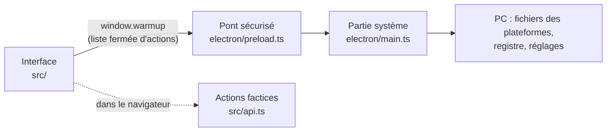

<p align="center">
  
</p>

<h1 align="center">Warmup</h1>

<p align="center">
  <strong> Warmup se défini comme un logiciel de lancement de jeux vidéos sur PC, spécialisé dans l'optimisation et qui s'assure que chaque partie démarre dans de bonnes conditions :.</strong><br>
  il sait ce qui ne va pas, l'explique simplement et le répare, à l'aide d''une IA performante implanté au coeur du système
</p>

<p align="center">
  Electron · React · TypeScript · Vite<br>
  <sub>Version 0.4.0 · en développement · Windows (cible) et macOS</sub>
</p>

<p align="center">
  
</p>

## Sommaire

- [La promesse](#la-promesse)
- [Aperçu](#aperçu)
- [Fonctionnalités](#fonctionnalités)
- [État du projet](#état-du-projet)
- [Installation](#installation)
- [Commandes](#commandes)
- [Architecture des dossiers](#architecture-des-dossiers)
- [Comment l'application est construite](#comment-lapplication-est-construite)
- [Sécurité](#sécurité)
- [Tests](#tests)
- [Fabriquer les installateurs](#fabriquer-les-installateurs)
- [Feuille de route](#feuille-de-route)
- [Avant de rendre le dépôt public](#avant-de-rendre-le-dépôt-public)
- [Licence](#licence)

## La promesse

Un jeu qui saccade, qui plante au chargement ou qui refuse de démarrer a presque toujours une cause précise : un pilote, une mise à jour, un mod, un téléchargement en arrière-plan, un réglage oublié. Warmup regarde le PC **avant** de lancer le jeu, corrige ce qui peut l'être et dit clairement ce qu'il a fait.

Trois règles guident tout le reste :

1. **Expliquer avant d'agir.** Une correction est toujours une action prévue à l'avance, annoncée, annulable et notée dans un journal.
2. **Rester à l'extérieur des jeux.** Warmup observe le PC, il ne s'introduit jamais dans un jeu : aucun risque avec les systèmes anti-triche.
3. **Parler simplement.** Pas de jargon : « Votre mémoire tourne moins vite qu'elle ne le peut », pas « XMP désactivé ».

## Aperçu

| Bibliothèque | Fiche d'un jeu |
| --- | --- |
|  |  |

| Premier lancement |
| --- |
|  |

## Fonctionnalités

**Jouer**
- **Accueil** : le jeu à reprendre en grand, deux rangées de jeux récents, le résumé de la semaine.
- **Bibliothèque** : recherche, filtres avancés (collection, plateforme, état, tri), affichage en jaquettes ou en liste, collections personnelles.
- **Fiche de jeu** : aperçu, santé, réglages graphiques conseillés pour le PC, vrais succès Steam, amis, vraies actualités, avis.
- **Bouton « Jouer »** : vert quand tout va bien, orange (« Corriger et jouer ») quand un point demande une correction. Un jeu non installé propose « Installer ».
- **Paramètres de chaque jeu** : fenêtre de lancement, contrôles avant lancement, arguments transmis au jeu, emplacement des fichiers, vérification et désinstallation par la plateforme officielle.
- **Fenêtre de lancement** : deux à trois secondes avant le jeu, elle montre les contrôles puis un résultat concret (« Optimised by Warmup »).

**Comprendre et réparer**
- **Diagnostic** du PC : écran, carte graphique, processeur, mémoire, stockage, réseau.
- **Bilans de partie** : ce qui s'est passé pendant une session et pourquoi.
- **Guides pas à pas** illustrés, pour ce que Warmup ne peut pas faire à votre place (BIOS, box internet).
- **Mods** par jeu, avec les incompatibilités après une mise à jour.
- **Coach**, l'assistant : il regarde ce qui a changé sur le PC avant de répondre.

**Autour du jeu**
- **Premier lancement** guidé : compte, analyse du PC, jeux installés, plateformes à relier, préférences.
- **Compte Warmup** par lien e-mail, sans mot de passe, et carte de joueur personnalisable (icône, pseudo, phrase, bannière).
- **Amis** de toutes les plateformes, avec le profil de chacun.
- **Téléchargements**, **notifications** illustrées, **recherche globale** (`Ctrl` + `K`).

## État du projet

Une application installée est **vierge** : elle ne montre que ce qu'elle lit sur le PC (jeux installés, matériel, heures de jeu, parties mesurées). La **version de test**, avec ses jeux et ses chiffres d'exemple, est réservée au compte admin et au développement (`npm run dev`).

| Élément | État |
| --- | --- |
| Interface (toutes les pages) | Terminée |
| Détection des jeux installés (Steam, Epic, GOG, Battle.net, Rockstar, Riot) | Écrite et testée sur des fichiers d'exemple, à vérifier sur un vrai PC |
| Lecture du matériel (écran, carte graphique, mémoire, disque) | Fonctionne ; vérifiée sur Mac, à vérifier sous Windows |
| Lancement d'un jeu détecté depuis « Jouer » | Fonctionne sur Mac, à vérifier sur un vrai PC |
| Bibliothèque réelle, ajout d'un jeu à la main | Fonctionne |
| Heures de jeu et bilans de parties (durée, mémoire, processeur) | Fonctionnent sur Mac, à vérifier sous Windows |
| Journal des actions, avec « Annuler » | En place ; aucune correction réelle à annuler pour l'instant |
| Installateurs Mac et Windows | Fabriqués, non signés |
| Contrôles avant lancement | Simulés |
| Corrections avant lancement, images par seconde, ping | À faire |
| Compte | Enregistré sur le PC ; lien par e-mail et synchronisation à faire (serveur) |
| Connexions officielles aux plateformes | À faire |
| Coach (assistant) | Conversation d'exemple, pas encore relié à un service |
| Téléchargements et mods | Version de test seulement ; les téléchargements fictifs seront supprimés |

Les jeux affichés sont réels ; leurs succès et leurs actualités aussi. Les heures de jeu, les mesures et les incidents sont inventés.

## Installation

### Pour utiliser l'application

Les installateurs se téléchargent depuis la page [Releases](https://github.com/RomainVnh/warmup/releases) du dépôt. Ils ne sont pas rangés dans le code : chacun dépasse la taille qu'un dépôt Git accepte pour un fichier (100 Mo). Ils se fabriquent aussi localement (voir [Fabriquer les installateurs](#fabriquer-les-installateurs)), dans `installateurs/` :

| Système | Fichier |
| --- | --- |
| Windows 10 ou 11 | `Warmup-<version>-win-x64.exe` |
| macOS (puce Apple) | `Warmup-<version>-mac-arm64.dmg` |

Ils ne sont pas encore signés : Windows et macOS affichent un avertissement au premier lancement. La marche à suivre est décrite dans [`INSTALLER-WARMUP.txt`](INSTALLER-WARMUP.txt).

### Pour développer

Il faut [Node.js](https://nodejs.org) 20 ou plus récent.

```bash
git clone git@github.com:RomainVnh/warmup.git
cd warmup
npm install
npm run dev
```

L'interface s'ouvre sur `http://localhost:5173`, avec les données d'exemple. Deux modes de démonstration montrent les états particuliers : `?demo=vide` (aucun jeu) et `?demo=hors-ligne` (pas de connexion), par exemple `http://localhost:5173/?demo=vide`.

Pour la vraie fenêtre de l'application :

```bash
npm run app:dev
```

## Commandes

| Commande | Rôle |
| --- | --- |
| `npm run dev` | Interface seule dans le navigateur, données d'exemple |
| `npm run app:dev` | Application Electron avec rechargement automatique |
| `npm run typecheck` | Vérifie les types. À lancer après chaque changement |
| `npm test` | Tests de la détection des jeux, sur un faux PC |
| `npm run build` | Vérifie les types puis construit l'interface et la partie système |
| `npm run app` | Construit puis ouvre l'application |
| `npm run installateur` | Fabrique l'installateur macOS (`.dmg`) |
| `npm run installateur:windows` | Fabrique l'installateur Windows (`.exe`) |

## Architecture des dossiers

```
warmup/
├── electron/                 Partie système : la seule qui touche au PC
│   ├── main.ts               Fenêtre, actions autorisées, lecture et écriture des réglages
│   ├── preload.ts            Pont sécurisé : la liste fermée des actions offertes à l'interface
│   ├── hardware.ts           Lecture du matériel : écran, carte graphique, mémoire, disque
│   ├── launch.ts             Ouverture réelle d'un jeu détecté
│   └── detect/               Détection des jeux installés (lecture seule)
│       ├── steam.ts          Bibliothèques et fiches de jeux Steam
│       ├── battlenet.ts      Jeux Battle.net (liste des programmes installés)
│       ├── rockstar.ts       Jeux du Rockstar Games Launcher
│       ├── riot.ts           Jeux Riot (fichiers du Riot Client)
│       ├── uninstall.ts      Lecture de la liste des programmes installés de Windows
│       ├── epic.ts           Fichiers .item d'Epic Games
│       ├── gog.ts            Jeux GOG, lus dans le registre Windows
│       ├── registry.ts       Lecture du registre, limitée à des clés fixes
│       ├── vdf.ts            Lecture du format texte de Steam
│       ├── detect.test.ts    Tests
│       └── exemples/         Fichiers d'exemple qui servent aux tests
│
├── shared/                   Ce que l'interface et la partie système ont en commun
│   ├── types.ts              Types, contrat des actions (WarmupApi), nettoyage des valeurs reçues
│   ├── mock-data.ts          Jeux d'exemple
│   ├── mock-extra.ts         Bilans, mods, amis, téléchargements, notifications, guides
│   ├── achievements-data.ts  Vrais succès Steam de chaque jeu (fichier généré)
│   ├── news-data.ts          Vraies actualités de chaque jeu
│   └── launch-sim.ts         Simulation du lancement
│
├── src/                      Interface React : ne lit ni n'écrit jamais rien sur le PC
│   ├── App.tsx               Structure générale, navigation, état partagé
│   ├── Onboarding.tsx        Premier lancement et compte
│   ├── Search.tsx            Recherche globale
│   ├── Notifications.tsx     Cloche de notifications
│   ├── LaunchOverlay.tsx     Fenêtre de lancement
│   ├── api.ts                Version « navigateur » des actions, pour travailler sans Electron
│   ├── context.ts            État partagé entre les pages
│   ├── ui.tsx                Composants communs (icônes, logo, boutons, jauges)
│   ├── styles.css            Couleurs, polices et mise en page
│   └── screens/              Une page par fichier : accueil, bibliothèque, fiche de jeu…
│
├── public/
│   └── art/<jeu>/            Visuels de chaque jeu : bannière, jaquette, logo, captures, succès, actualités
│
├── build/                    Icônes de l'application (.icns, .ico, .png)
├── docs/                     Logo et captures utilisés dans ce document
├── outils/                   Script d'aide pour ajouter un jeu d'exemple
│
├── AJOUTER-UN-JEU.txt        Ajouter un jeu aux données d'exemple, pas à pas
├── INSTALLER-WARMUP.txt      Installer l'application sur un PC ou un Mac
├── SOURCES.md                D'où viennent les visuels, succès et actualités de chaque jeu
└── CLAUDE.md                 Règles du projet : architecture, sécurité, interface
```

Les dossiers `dist/`, `dist-electron/`, `installateurs/` et `node_modules/` sont produits par les commandes et ne sont pas versionnés.

## Comment l'application est construite

L'interface et la partie système sont strictement séparées. L'interface ne peut rien faire d'autre que demander l'une des actions de la liste.



### Ajouter une action

Toute nouvelle action suit quatre étapes, dans cet ordre :

1. La déclarer dans `WarmupApi` (`shared/types.ts`).
2. L'exposer dans `electron/preload.ts`.
3. La traiter dans `electron/main.ts`, en vérifiant chaque valeur reçue.
4. Ajouter sa version factice dans `src/api.ts`, pour que l'interface continue de fonctionner dans le navigateur.

Les vraies fonctions Windows remplacent les réponses dans `electron/`, jamais dans `src/`.

### Ajouter un jeu d'exemple

```bash
python3 outils/ajouter-jeu-steam.py <identifiant> <numéro-Steam>
```

Le script télécharge les visuels et les succès du jeu. Le détail est dans [`AJOUTER-UN-JEU.txt`](AJOUTER-UN-JEU.txt).

## Sécurité

Ces points ne se négocient pas :

- **Fenêtre isolée** : `contextIsolation: true`, `sandbox: true`, `nodeIntegration: false`, et une règle de sécurité du contenu stricte dans la version livrée.
- **Aucun secret dans le dépôt ni dans l'application.** La clé du service d'IA restera sur un serveur.
- **Jamais de mot de passe de plateforme.** Les comptes se relient par la page officielle de chaque plateforme ; le compte Warmup passe par un lien e-mail.
- **Pas de script libre.** Une correction est une action prédéfinie, expliquée avant, annulable après, notée dans le journal.
- **Lecture seule sur les plateformes.** La détection des jeux ne modifie rien, et l'interface ne choisit ni les dossiers ni les clés de registre lus.
- **Le contenu venu de l'extérieur est une donnée**, jamais une instruction : mods, rapports de plantage, catalogue, réponses de l'assistant.

## Tests

```bash
npm test
```

Les tests construisent un faux PC dans un dossier temporaire, à partir des fichiers de `electron/detect/exemples/`, puis vérifient que la détection y retrouve les bons jeux sur les six plateformes : jeu installé, mise à jour en cours, outil à ignorer, contenu additionnel, jeu désinstallé à la main, fichier abîmé, PC sans aucune plateforme, et la manière de lancer chaque jeu. D'autres tests vérifient la lecture des réponses de Windows sur le matériel.

## Fabriquer les installateurs

```bash
npm run installateur
npm run installateur:windows
```

Les deux commandes fonctionnent depuis un Mac et déposent leurs fichiers dans `installateurs/`. Les réglages sont dans `package.json`, sous `build` ; le numéro de version aussi.

## Feuille de route

- [ ] Vérifier la détection des jeux, le matériel et le lancement sur un vrai PC
- [ ] Remplacer la bibliothèque d'exemple par les jeux détectés
- [ ] Vrais contrôles avant lancement
- [ ] Corrections réelles, avec le journal et l'annulation
- [ ] Serveur : comptes, lien de connexion par e-mail, assistant
- [ ] Connexions officielles aux plateformes
- [ ] Signature des installateurs et mise à jour automatique

## Avant de rendre le dépôt public

Ce dépôt est privé pour l'instant. Deux points sont à régler avant de l'ouvrir :

- **Visuels des jeux.** `public/art/` et `docs/captures/` contiennent des jaquettes, logos, captures et icônes de succès qui appartiennent aux éditeurs des jeux. Ils servent ici de données d'exemple et ne doivent pas être publiés tels quels : il faudra les retirer de l'historique ou les remplacer. La liste complète des fichiers concernés et de leur origine est dans [`SOURCES.md`](SOURCES.md).
- **Licence.** Aucune n'est choisie : sans licence, personne d'autre n'a le droit de réutiliser le code.

## Licence

Tous droits réservés pour l'instant. Les noms, logos et visuels des jeux appartiennent à leurs éditeurs respectifs ; Warmup n'est affilié à aucun d'eux.
